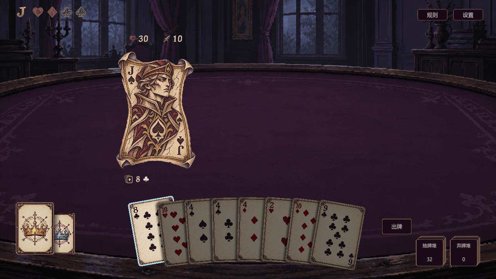
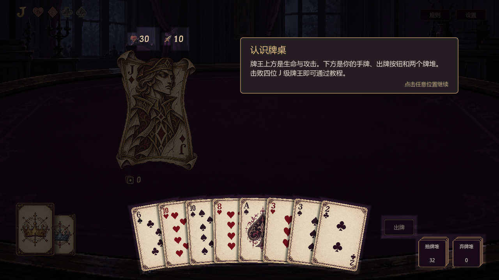

# Kill the Card Kings

[English](docs/README.en.md)

一款用扑克牌作战的单人策略游戏。从 J 到 K，依次挑战四种花色的十二位牌王。你会现在打出手牌发动花色效果，还是留着它抵挡下一次反击？

## 怎么启动

1. [下载项目 ZIP](https://github.com/Mira-L-Git/kill_the_card_kings/archive/refs/heads/main.zip) 并解压。
2. 用 Godot 4.7.2 导入解压后的 `project.godot`，按 `F5` 运行。

## 快速上手

1. **先玩新手教程。** 从主菜单进入「新手教程」，跟着牌桌上的提示出牌，击败四位 J 级牌王。
2. **选牌并点击「出牌」。** 可以单出一张 4–10 或已获得的 J、Q、K，也可以给它搭配一张 A。2 或 3 可以单出，也可以把同点数的几张一起打出。
3. **算好伤害和花色。** 出牌总点数是基础伤害，也决定花色效果的强度。牌王会封锁与自己同花色的效果，基础伤害照常结算。
4. **留牌抵伤。** 牌王反击时先扣护盾，剩余伤害靠点击手牌、逐张弃置来抵消。手牌耗尽时，大王和小王能依次让你复活。把牌王的生命恰好打到 0，还能将它招入手牌，手满时放到抽牌堆顶。

| 花色 | 效果 |
| --- | --- |
| ♥ 红桃 | 从弃牌堆回收牌，放回抽牌堆底 |
| ♦ 方片 | 抽牌，手牌上限为 8 张 |
| ♣ 梅花 | 追加伤害 |
| ♠ 黑桃 | 获得本回合的护盾 |

