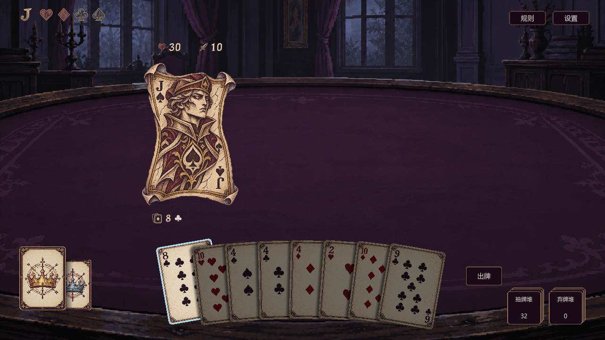
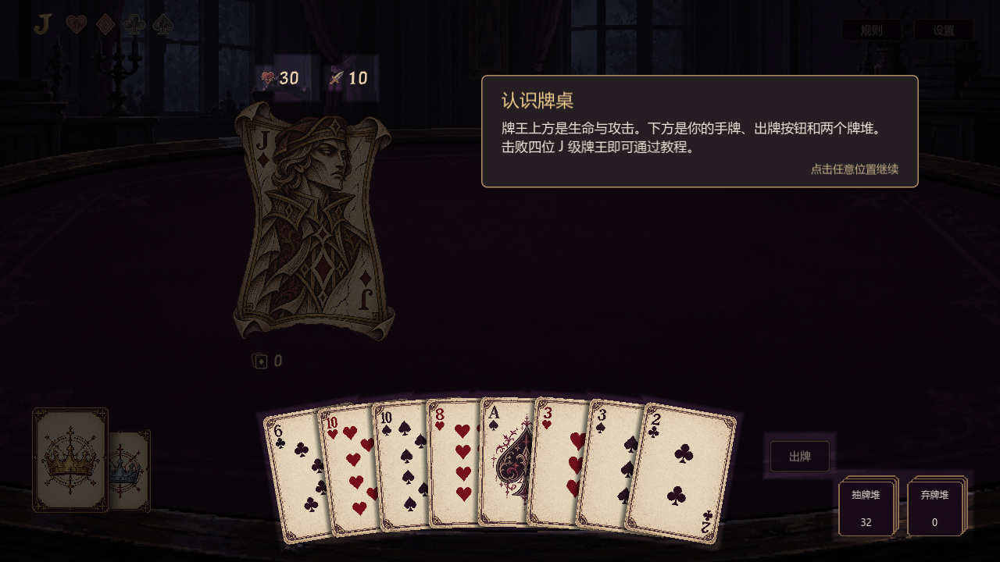

# Kill the Card Kings

[简体中文](../README.md)

A single-player strategy game played with a deck of cards. Fight twelve royal opponents across four suits, from Jacks to Kings. Will you play a card now for its suit effect or save it to defend against the next counterattack?

## Run the game

1. [Download the project ZIP](https://github.com/Mira-L-Git/kill_the_card_kings/archive/refs/heads/main.zip) and extract it.
2. Open `project.godot` in Godot 4.7.2 and press `F5` to launch. The game menus are in Simplified Chinese.

## Quick tutorial

1. **Start with the tutorial.** Choose **新手教程** (Tutorial) from the main menu and follow the on-screen prompts to defeat four Jacks.
2. **Select cards, then click 出牌 (Play).** Play one card from 4 to 10 or a captured Jack, Queen, or King. You can pair that card with one Ace. Play 2s and 3s singly or in groups of the same rank.
3. **Count your damage and suit effects.** The total card value is your base damage and sets the strength of each suit effect. An enemy blocks the effect of its own suit. Base damage still applies.
4. **Save cards for defense.** Your shield absorbs the counterattack first. Click cards to discard them one at a time to cover the remaining damage. Your two Jokers can revive you in order when you run out of cards. If you bring an enemy’s health to exactly zero, it joins your hand, or goes on top of the draw pile if your hand is full.

| Suit | Effect |
| --- | --- |
| ♥ Hearts | Recover cards from the discard pile to the bottom of the draw pile |
| ♦ Diamonds | Draw cards, up to the eight-card hand limit |
| ♣ Clubs | Deal extra damage |
| ♠ Spades | Gain a shield for the current turn |

